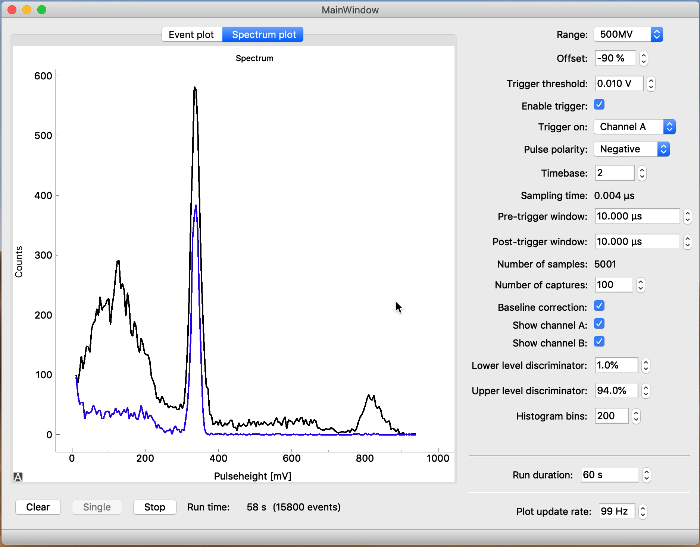

# A GUI for gamma spectroscopy using a PicoScope

## Introduction

This is a data acquisition app for gamma spectroscopy. The Qt app requires a 5000-series PicoScope (e.g. the 5242D) for data acquisition.

Gamma spectroscopy of nuclear sources is commonly performed using either custom hardware (somewhat cheaper, easier to use, but less versatile) or modular hardware like NIM-crates (more expensive, harder to use, but more versatile). For the undergraduate physics lab at the Vrije Universiteit Amsterdam and the University of Amsterdam we require the versatility of modular hardware, but would like the ease-of-use of custom solutions. This way, students can focus on their research instead of working through a bunch of manuals.

Typically, a gamma detector (e.g. a NaI-scintillator/PMT or HPGe-detector) is connected to an amplifier which is connected to a multi-channel analyzer (MCA). Proprietary software must be used to read out the MCA. For more elaborate setups, a single-channel analyzer or pulse shaper is added to the mix. This can easily result in a time-consuming quest to find the cause of a very common situation: "it doesn't work."

We've decided to replace all NIM modules with a single PicoScope device. This is a digital oscilloscope which is connected over USB to a PC or laptop. Using the SDK it is easy to interface with the device and to write custom software for use by our students.



Screenshot of the GUI showing a plot of the gamma spectrum of a nuclear source (sodium-22, black line). Another detector at the opposite side of the source picks up coincident annihilation radiation gammas.

## Installation

You need to install the [PicoSDK](https://www.picotech.com/downloads) for your platform before you can use this application. You need to select your oscilloscope before it shows the download link.

You can install the application using `pip` in any Python environment, but the recommended way to install gamma-spectroscopy is using [uv](https://docs.astral.sh/uv/):
```console
uv tool install gamma-spectroscopy
```
The `gamma-spectroscopy` utility is available from the terminal. You can also run the tool without installing with:
```console
uvx gamma-spectroscopy
```
This has the benefit that you're always using the latest version. To run the development version directly from GitHub, run:
```console
uvx git+https://github.com/davidfokkema/gamma-spectroscopy
```
